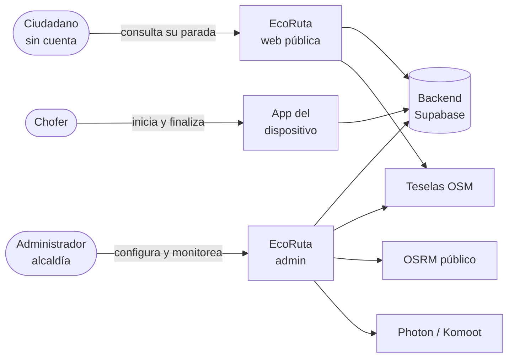
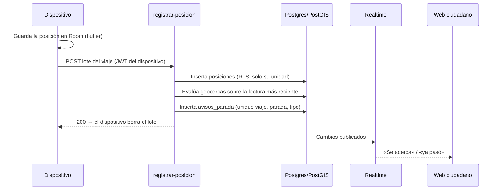

# Arquitectura

| Campo | Valor |
|---|---|
| Estado | Aprobado |
| Responsable | Gabrieli Murillas Ramírez |
| Última revisión | 2026-11-04 |

| Documento | Contenido |
|---|---|
| Este archivo | Contexto, contenedores, flujos y stack (modelo C4, niveles 1 y 2) |
| [modelo-de-datos.md](modelo-de-datos.md) | Tablas, invariantes, RLS y funciones |
| [geocercas-avisos-y-eta.md](geocercas-avisos-y-eta.md) | Algoritmo crítico: los 5 pasos, los avisos y el tiempo estimado |
| [contrato-vinculacion.md](../contrato-vinculacion.md) | Frontera con la app Android (se queda en `docs/` porque la app lo referencia por esa ruta) |
| [adr/](adr/README.md) | Registro de decisiones de arquitectura |

---

## 1. Contexto (C4, nivel 1)



## 2. Contenedores (C4, nivel 2)

| Contenedor | Tecnología | Responsabilidad | Repositorio |
|---|---|---|---|
| Web pública | Next.js App Router, React 19, Tailwind 4, react-leaflet | Seguimiento del ciudadano; lectura anónima y Realtime | `ecoruta-web/` (rutas públicas) |
| Web de administración | Ídem, en `/admin`, sesión en cookies (`@supabase/ssr`) | Configuración, monitoreo e históricos | `ecoruta-web/` (`/admin`) |
| App del dispositivo | Kotlin, Jetpack Compose, Room, WorkManager, Retrofit | Telemetría con buffer offline, latido e incidencias | Repositorio aparte (`eco-ruta-app`) |
| Base de datos | PostgreSQL + PostGIS (Supabase) | Modelo, RLS y funciones geoespaciales | `sql/` |
| Edge Function `vincular-dispositivo` | Deno/TypeScript, `verify_jwt=false` | Canje del código; graba `app_metadata.unidad_id` | `supabase/functions/` |
| Edge Function `registrar-posicion` | Deno/TypeScript, `verify_jwt=true` | Recibe la telemetría y evalúa geocercas y avisos de forma síncrona | `supabase/functions/` |
| Realtime | Supabase Realtime | Difunde posiciones, viajes, incidencias y avisos | `sql/12_realtime_monitoreo.sql` |
| Hospedaje web | Vercel (equipo eva-projecs, proyecto eco-ruta) | Despliegue de `master` | — |

## 3. Flujos clave

### 3.1 Telemetría y avisos



Si falla la evaluación, el error vuelve al dispositivo y este reintenta desde su buffer
([ADR-0004](adr/0004-evaluacion-sincrona.md)).

### 3.2 Vinculación

Admin → «Vincular» → código de 5 caracteres (10 min, un solo uso) → el teléfono llama a
`vincular-dispositivo` con la clave publicable → la función crea la cuenta Auth con
`app_metadata.unidad_id` → el teléfono recibe la sesión. El detalle está en el
[contrato](../contrato-vinculacion.md).

### 3.3 Sesión y recuperación de contraseña del admin

- **«Mantener la sesión» desmarcado:** el servidor, el proxy y el cliente del navegador
  escriben las cookies de Supabase sin vencimiento mientras exista la cookie
  `ecoruta-sesion-corta` (`lib/supabase/sesion-corta.ts`). La marca hace falta porque cada
  renovación del token vuelve a escribir las cookies con 400 días.
- **Recuperación:** `/admin/recuperar` → `resetPasswordForEmail` (respuesta neutra: no revela
  si la cuenta existe, ni siquiera por el límite de envíos) → enlace del correo →
  `/admin/auth/confirmar` (canjea `code` o `token_hash`; solo cuentas con rol admin; sesión
  corta; pone la marca de un solo uso `ecoruta-recuperacion`, 15 min) →
  `/admin/restablecer` (exige la marca) → contraseña nueva → panel.
- Con la plantilla de correo por defecto llega un `code` (PKCE): el enlace solo sirve en el
  mismo navegador donde se pidió, y solo el más reciente.

### 3.4 Consulta del ciudadano

Ubicación del navegador → RPC `paradas_cercanas(lat, lng)` → selección de la parada →
`llegadas_a_parada` (tiempo estimado) → suscripción Realtime a `avisos_parada` de esa parada.

## 4. Organización del código web

```
app/  →  features/  →  services/  →  lib/supabase
                    ↘  domain/   (puro, sin dependencias)
```

Solo `services/` importa Supabase. Las reglas completas y los límites de tamaño están en
`CLAUDE.md` § Arquitectura de código y en las skills `web-capas` y `servicio-datos`.

## 5. Atributos de calidad

| Atributo | Táctica |
|---|---|
| Disponibilidad con red degradada | Buffer offline de 2 h; entrega del lote completo; reintentos con WorkManager |
| Exactitud | Filtro de exactitud, suavizado, permanencia e histéresis |
| Seguridad | RLS en todas las tablas; claims en `app_metadata`; `service_role` solo en el servidor |
| Rendimiento geoespacial | Índices GiST en toda columna `geography` |
| Calibrabilidad | Tabla `parametros`, leída por el servidor, la web y la app |
| Costo | Servicios gestionados en planes gratuitos; Leaflet y OSM sin clave |

## 6. Despliegue y entornos

| Entorno | Dónde | Notas |
|---|---|---|
| Producción web | `eco-ruta-nine.vercel.app` | Push a `master`; `autoAssignCustomDomains` debe estar encendido |
| Backend | Supabase `yumfwnqvmcitjnskazgx` | Las migraciones de `sql/` se aplican a mano (SQL Editor o CLI) |
| Edge Functions | `npx supabase functions deploy <f>` | — |
| Pruebas de SQL | Clúster desechable de Postgres 17 + PostGIS | Ver la guía del repositorio |
| Supabase Auth | *Authentication → URL Configuration → Redirect URLs* | Debe incluir `https://eco-ruta-nine.vercel.app/admin/auth/confirmar` (y la de `localhost`). Si falta, Supabase manda el enlace de recuperación a la *Site URL* sin avisar y nadie lo canjea |
| Correo de Supabase | SMTP por defecto o propio | El SMTP por defecto solo entrega a correos de miembros del equipo de Supabase y con límite por hora. Para cuentas del ente gestor hace falta SMTP propio. Los rechazos quedan en el registro de Vercel (`[ecoruta] restablecer contraseña`), no en pantalla |
