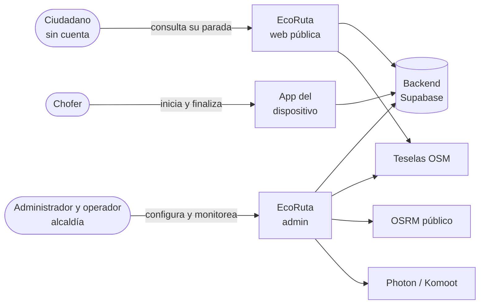
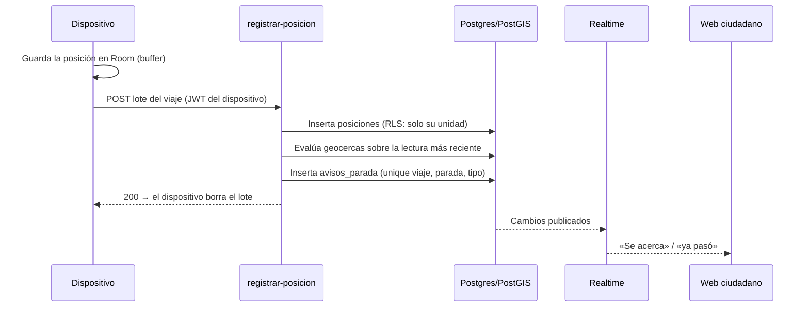
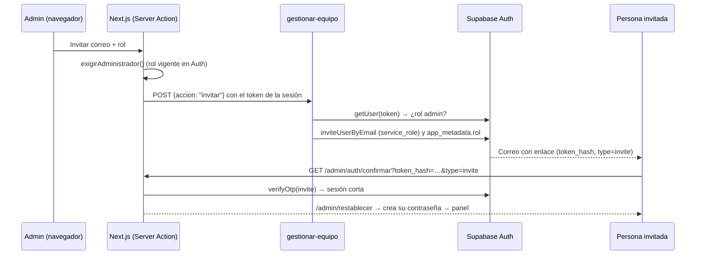

# Arquitectura

| Campo | Valor |
|---|---|
| Estado | Aprobado |
| Responsable | Gabrieli Murillas Ramírez |
| Última revisión | 2026-11-10 |

| Documento | Contenido |
|---|---|
| Este archivo | Contexto, contenedores, flujos y stack (modelo C4, niveles 1 y 2) |
| [modelo-de-datos.md](modelo-de-datos.md) | Tablas, invariantes, RLS y funciones |
| [geocercas-avisos-y-eta.md](geocercas-avisos-y-eta.md) | Algoritmo crítico: los 5 pasos, los avisos y el tiempo estimado |
| [contrato-vinculacion.md](../contrato-vinculacion.md) | Frontera con la app Android (se queda en `docs/` porque la app lo referencia por esa ruta) |
| [adr/](adr/README.md) | Registro de decisiones de arquitectura |

---

## 1. Contexto (C4, nivel 1)



## 2. Contenedores (C4, nivel 2)

| Contenedor | Tecnología | Responsabilidad | Repositorio |
|---|---|---|---|
| Web pública | Next.js App Router, React 19, Tailwind 4, react-leaflet | Seguimiento del ciudadano; lectura anónima y Realtime | `ecoruta-web/` (rutas públicas) |
| Web de administración | Ídem, en `/admin`, sesión en cookies (`@supabase/ssr`) | Configuración, monitoreo e históricos | `ecoruta-web/` (`/admin`) |
| App del dispositivo | Kotlin, Jetpack Compose, Room, WorkManager, Retrofit | Telemetría con buffer offline, latido e incidencias | Repositorio aparte (`eco-ruta-app`) |
| Base de datos | PostgreSQL + PostGIS (Supabase) | Modelo, RLS y funciones geoespaciales | `sql/` |
| Edge Function `vincular-dispositivo` | Deno/TypeScript, `verify_jwt=false` | Canje del código; graba `app_metadata.unidad_id` | `supabase/functions/` |
| Edge Function `registrar-posicion` | Deno/TypeScript, `verify_jwt=true` | Recibe la telemetría y evalúa geocercas y avisos de forma síncrona | `supabase/functions/` |
| Edge Function `gestionar-equipo` | Deno/TypeScript, `verify_jwt=true`; exige rol admin | Lista, invita, cambia el rol y quita el acceso de las cuentas del panel ([ADR-0015](adr/0015-roles-del-panel-y-equipo.md)) | `supabase/functions/` |
| Realtime | Supabase Realtime | Difunde posiciones, viajes, incidencias y avisos | `sql/12_realtime_monitoreo.sql` |
| Hospedaje web | Vercel (equipo eva-projecs, proyecto eco-ruta) | Despliegue de `master` | — |

## 3. Flujos clave

### 3.1 Telemetría y avisos



Si falla la evaluación, el error vuelve al dispositivo y este reintenta desde su buffer
([ADR-0004](adr/0004-evaluacion-sincrona.md)).

### 3.2 Vinculación

Admin → «Vincular» → código de 5 caracteres (10 min, un solo uso) → el teléfono llama a
`vincular-dispositivo` con la clave publicable → la función crea la cuenta Auth con
`app_metadata.unidad_id` → el teléfono recibe la sesión. El detalle está en el
[contrato](../contrato-vinculacion.md).

### 3.3 Sesión y recuperación de contraseña del admin

- **«Mantener la sesión» desmarcado:** el servidor, el proxy y el cliente del navegador
  escriben las cookies de Supabase sin vencimiento mientras exista la cookie
  `ecoruta-sesion-corta` (`lib/supabase/sesion-corta.ts`). La marca hace falta porque cada
  renovación del token vuelve a escribir las cookies con 400 días.
- **Recuperación:** `/admin/recuperar` → `resetPasswordForEmail` (respuesta neutra: no revela
  si la cuenta existe, ni siquiera por el límite de envíos) → enlace del correo →
  `/admin/auth/confirmar` (canjea `code` o `token_hash`; solo cuentas con rol del panel; sesión
  corta; pone la marca de un solo uso `ecoruta-recuperacion`, 15 min) →
  `/admin/restablecer` (exige la marca) → contraseña nueva → panel.
- Con la plantilla de correo por defecto llega un `code` (PKCE): el enlace solo sirve en el
  mismo navegador donde se pidió, y solo el más reciente.

### 3.4 Equipo del panel: roles e invitaciones

Dos roles ([ADR-0015](adr/0015-roles-del-panel-y-equipo.md)): **admin** (todo) y **operador**
(monitorea y atiende incidencias; el resto en lectura). El detalle de permisos está en el
[modelo de datos](modelo-de-datos.md#roles-del-panel-adr-0015-sql17).



- **La clave `service_role` no entra en la web.** La web solo reenvía el token de la sesión; la
  función lo valida contra Auth y recién entonces usa su clave.
- **Tres barreras por cada acción de escritura:** la interfaz no muestra el botón al operador;
  la Server Action llama a `exigirAdministrador()`; RLS rechaza la escritura en la base.
- **Reglas del equipo** (`supabase/functions/_dominio/equipo.ts`, puras): nadie cambia su propio
  rol ni se quita el acceso; siempre queda un admin que ya aceptó su invitación; solo se
  listan y modifican cuentas con rol `admin` u `operador`, nunca las de los teléfonos.
- **Quitar el acceso borra la cuenta.** Caen sus sesiones; el token de acceso que ya tenía
  vale hasta su vencimiento (una hora por defecto, brecha TS-11).
- **El enlace de invitación exige la plantilla con `token_hash`** (§ 7): la invitación la abre
  otra persona en otro navegador, y con la plantilla por defecto el enlace no llega al servidor.

### 3.5 Consulta del ciudadano

Ubicación del navegador → RPC `paradas_cercanas(lat, lng)` → selección de la parada →
`llegadas_a_parada` (tiempo estimado) → suscripción Realtime a `avisos_parada` de esa parada.

## 4. Organización del código web

```
app/  →  features/  →  services/  →  lib/supabase
                    ↘  domain/   (puro, sin dependencias)
```

Solo `services/` importa Supabase. Las reglas completas y los límites de tamaño están en
`CLAUDE.md` § Arquitectura de código y en las skills `web-capas` y `servicio-datos`.

## 5. Atributos de calidad

| Atributo | Táctica |
|---|---|
| Disponibilidad con red degradada | Buffer offline de 2 h; entrega del lote completo; reintentos con WorkManager |
| Exactitud | Filtro de exactitud, suavizado, permanencia e histéresis |
| Seguridad | RLS en todas las tablas; claims en `app_metadata`; `service_role` solo en el servidor |
| Rendimiento geoespacial | Índices GiST en toda columna `geography` |
| Calibrabilidad | Tabla `parametros`, leída por el servidor, la web y la app |
| Costo | Servicios gestionados en planes gratuitos; Leaflet y OSM sin clave |

## 6. Despliegue y entornos

| Entorno | Dónde | Notas |
|---|---|---|
| Producción web | `eco-ruta-nine.vercel.app` | Push a `master`; `autoAssignCustomDomains` debe estar encendido |
| Backend | Supabase `yumfwnqvmcitjnskazgx` | Las migraciones de `sql/` se aplican a mano (SQL Editor o CLI) |
| Edge Functions | `npx supabase functions deploy <f> --remote=yumfwnqvmcitjnskazgx --use-api --yes` | `vincular-dispositivo`, `registrar-posicion`, `gestionar-equipo` |
| Pruebas de SQL | Clúster desechable de Postgres 17 + PostGIS | Ver la guía del repositorio |
| Supabase Auth | *Authentication → URL Configuration → Redirect URLs* | Debe incluir `https://eco-ruta-nine.vercel.app/admin/auth/confirmar` (y la de `localhost`). Si falta, Supabase manda el enlace de recuperación a la *Site URL* sin avisar y nadie lo canjea |
| Correo de Supabase | SMTP por defecto o propio | El SMTP por defecto solo entrega a correos de miembros del equipo de Supabase y con límite por hora. Para cuentas del ente gestor hace falta SMTP propio. Los rechazos quedan en el registro de Vercel (`[ecoruta] restablecer contraseña`), no en pantalla |

## 7. Configurar Supabase para el equipo del panel

Pasos de una sola vez, en el panel de Supabase del proyecto `yumfwnqvmcitjnskazgx`. Sin ellos
la sección Equipo carga, pero las invitaciones no se pueden aceptar.

1. **Aplicar la migración de roles.** `sql/17_roles_del_panel.sql` en el SQL Editor, o
   `npx supabase db query --remote=yumfwnqvmcitjnskazgx --yes -f sql/17_roles_del_panel.sql`.
   Es idempotente.
2. **Desplegar la función.**
   `npx supabase functions deploy gestionar-equipo --remote=yumfwnqvmcitjnskazgx --use-api --yes`.
   No necesita secretos nuevos: Supabase le inyecta `SUPABASE_URL` y
   `SUPABASE_SERVICE_ROLE_KEY`. Se deja `verify_jwt` encendido (el valor por defecto).
3. **Plantilla del correo de invitación.** *Authentication → Emails → Templates → Invite user*.
   El enlace del cuerpo tiene que ser exactamente este (el resto del texto es libre):

   ```html
   <h2>Te invitaron al panel de EcoRuta San Juan</h2>
   <p>Abre este enlace para crear tu contraseña:</p>
   <p><a href="{{ .RedirectTo }}?token_hash={{ .TokenHash }}&type=invite">Crear mi contraseña</a></p>
   ```

   Por qué: la plantilla por defecto usa `{{ .ConfirmationURL }}`, que pasa por Supabase y
   devuelve la sesión en el fragmento de la dirección (`#access_token=…`). El fragmento no
   viaja al servidor, así que `/admin/auth/confirmar` no tendría nada que canjear. Con
   `token_hash` el enlace llega directo a la web y sirve desde cualquier navegador.
4. **(Recomendado) La misma idea en *Reset password*:**
   `<a href="{{ .RedirectTo }}?token_hash={{ .TokenHash }}&type=recovery">`. Con eso el enlace
   de recuperación deja de depender del navegador donde se pidió (§ 3.3).
5. **Redirect URLs.** *Authentication → URL Configuration → Redirect URLs* debe incluir
   `https://eco-ruta-nine.vercel.app/admin/auth/confirmar` y
   `http://localhost:3000/admin/auth/confirmar` (ya hacían falta para la recuperación). Si la
   dirección no está en la lista, `{{ .RedirectTo }}` cae a la *Site URL* y el enlace del
   correo abre la portada en vez de la pantalla de contraseña.
6. **Vigencia del enlace.** *Authentication → Providers → Email → Email OTP Expiration*. Una
   invitación suele abrirse horas después: conviene subirla a 86400 s (24 h, el máximo). Si
   vence, el admin la reenvía desde Equipo.
7. **Cerrar el registro público.** *Authentication → Providers → Email →* desactivar *Allow new
   users to sign up*. Las invitaciones siguen funcionando; lo que se cierra es que cualquiera
   cree cuentas (sin rol, y por eso sin acceso, pero ocupan correos que luego no se pueden
   invitar).
8. **SMTP propio.** El SMTP por defecto de Supabase solo entrega a correos de miembros del
   equipo de Supabase y con un límite de pocos correos por hora (§ 6). Para invitar a personal
   de la alcaldía hace falta configurar un SMTP propio en *Authentication → Emails → SMTP
   Settings*.
9. **Primer administrador.** Las cuentas admin que ya existen no cambian. Si hiciera falta crear
   una a mano: *Authentication → Users → Add user* y, en el SQL Editor,
   `update auth.users set raw_app_meta_data = raw_app_meta_data || '{"rol":"admin"}' where email = '…';`.

La web no necesita variables de entorno nuevas en Vercel.
