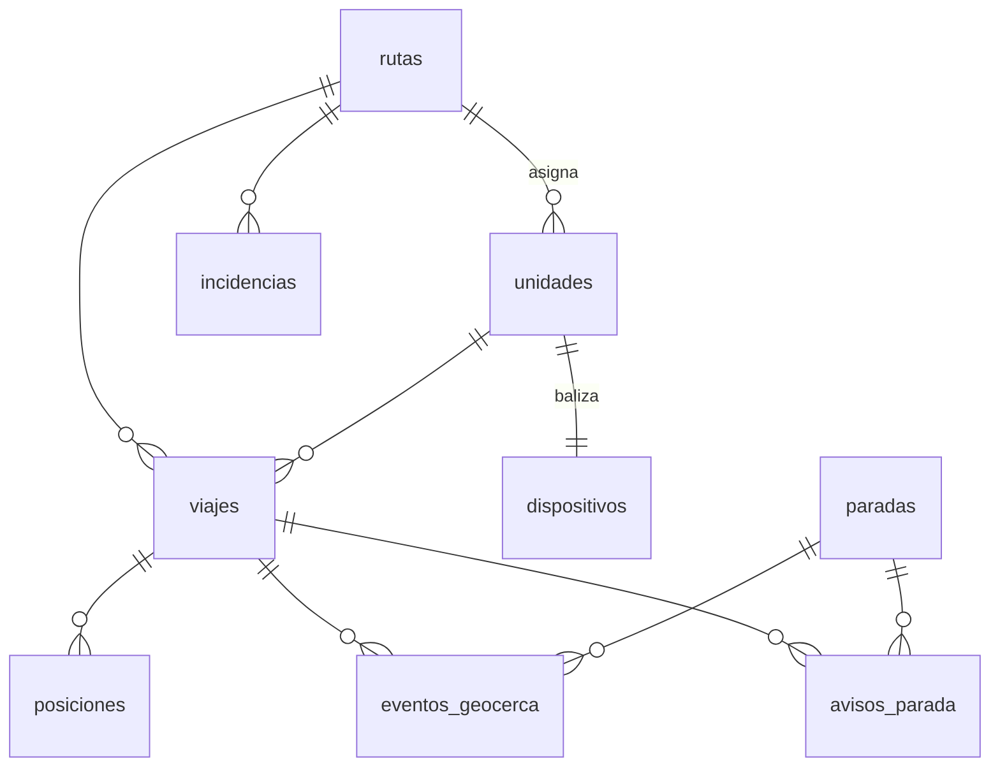

# Modelo de datos

| Campo | Valor |
|---|---|
| Estado | Aprobado |
| Fuente autoritativa | `sql/01_schema.sql` (este documento la resume; si difieren, gana el SQL) |
| Última revisión | 2026-11-04 |

## 1. Entidades

| Tabla | Rol | Columnas clave |
|---|---|---|
| `rutas` | Recorrido y servicio | `tipo` (texto libre), `icono`, `color` (token), `trazado` (LineString), `puntos_clave` (jsonb), `activa` |
| `paradas` | Paradas de la ciudad | `ubicacion` (Point), `radio_geocerca_m` (150 por defecto), `notifica` |
| `unidades` | Vehículos | `ruta_id`, `activa` |
| `dispositivos` | Teléfono-baliza | `unidad_id` (unique), `auth_user_id`, código y expiración, `ultima_bateria`, `ultima_senal_at` |
| `viajes` | De «iniciar» a «finalizar» | Un solo viaje abierto por unidad (índice único parcial) |
| `posiciones` | Telemetría (alta escritura) | `ubicacion`, `velocidad_kmh`, `exactitud_m`, `usable`, `capturado_at` y `recibido_at` |
| `eventos_geocerca` | Estado interno del algoritmo | `unique (viaje_id, parada_id)`; `entro_at`, `notificado_at` y `salio_at` |
| `avisos_parada` | Lo que se publica al ciudadano | `tipo ∈ {acercandose, paso}`; `unique (viaje_id, parada_id, tipo)` |
| `incidencias` | Reportes del chofer | `tipo ∈ {calle_cerrada, falla_mecanica, desvio, congestion, otro}`; `otro` exige descripción |
| `parametros` | Valores calibrables | `clave`, `valor` y `descripcion` |

## 2. Invariantes que no se negocian

1. Toda columna geográfica es `geography(…, 4326)` con índice **GiST**.
2. Ningún valor calibrable se escribe fijo en el código: vive en `parametros`.
3. Hay un evento de geocerca por (viaje, parada) y un aviso por (viaje, parada, tipo). Lo
   garantiza la base, no la lógica.
4. Las paradas son de la ciudad; qué rutas pasan lo calcula la vista `paradas_por_ruta` (a menos
   de `distancia_parada_trazado_m` del trazado). Una ruta sin trazado no pasa por ninguna.
5. `rutas.tipo` es texto libre; la unidad hereda el servicio de su ruta.
6. `types/database.generated.ts` se genera (`npm run types:db`); nunca se edita a mano.

## 3. Parámetros calibrables (valores actuales)

| Clave | Valor | Uso |
|---|---|---|
| `permanencia_minima_s` | 45 | Segundos dentro de la geocerca antes de darla por válida |
| `histeresis_salida_s` | 30 | Segundos fuera antes de confirmar la salida |
| `exactitud_maxima_m` | 50 | Lecturas peores no evalúan geocercas |
| `sin_senal_umbral_s` | 300 | Unidad marcada como perdida |
| `bateria_alerta_pct` | 15 | Alerta de batería en el admin |
| `emision_movimiento_s` | 5 | Intervalo de emisión en movimiento |
| `emision_detenido_s` | 30 | Intervalo de emisión detenido y latido |
| `radio_aproximacion_m` | 500 | Anillo del aviso «se acerca» |
| `distancia_parada_trazado_m` | 40 | Parada asociada a una ruta |
| `penalizacion_incidencia_pct` | 25 | Margen que suma al tiempo estimado una incidencia activa |

> **Ninguno está calibrado todavía.** Se ajustan tras la prueba de campo (SIS-08) con un
> `update`, sin tocar código.

Parámetros previstos por el PRD (todavía no existen): `eta_historico_min_viajes`,
`eta_historico_franja_min` y `retencion_posiciones_dias`.

## 4. Seguridad a nivel de fila

| Actor | Cómo se identifica | Puede |
|---|---|---|
| Público (`anon`) | Sin sesión | Leer rutas y unidades activas, paradas, posiciones usables **de viajes abiertos**, viajes abiertos, incidencias activas, avisos y parámetros |
| Dispositivo | JWT con `app_metadata.unidad_id` | Insertar posiciones e incidencias de **su** unidad; gestionar **sus** viajes |
| Admin | JWT con `app_metadata.rol = 'admin'` | Todo |

`app_metadata` solo se escribe desde el servidor; `user_metadata` nunca autoriza nada.

La exposición pública se limita a los viajes abiertos (ADR-0012, `sql/13`).

## 5. Funciones y vistas

| Objeto | Tipo | Uso |
|---|---|---|
| `paradas_por_ruta` | Vista | Rutas que pasan por cada parada, según el trazado |
| `paradas_cercanas(lat, lng)` | RPC, invoker | Paradas cerca del ciudadano |
| `llegadas_a_parada(parada)` | RPC, invoker | Unidades en camino y tiempo estimado |
| `rutas_para_mapa`, `paradas_de_ruta`, `paradas_de_la_ciudad` | RPC | Lectura para los mapas |
| `guardar_trazado_de_ruta`, `crear_parada`, `mover_parada` | RPC | Edición del admin |
| `resumen_historicos(dias)` | RPC | Históricos del admin. Desde `sql/16`, también `incidencias_activas` |
| `inicio_del_periodo(dias)` | Auxiliar | Medianoche de Caracas de hace `dias − 1` días: el período de los históricos son días completos, igual que el gráfico (`sql/16`) |
| `viajes_por_dia(dias)` | RPC | Históricos del admin: viajes cerrados por día (hora de Caracas) y ruta. En `sql/15` |
| `resumen_por_ruta(dias)` | RPC | Históricos del admin: viajes, duración, cobertura e incidencias (y cuántas siguen activas) por ruta. En `sql/15` |
| `viajes_grabados`, `recorrido_de_viaje` | RPC | Trazado desde un viaje grabado |
| `estado_flota` | RPC | Monitoreo |
| `canjear_codigo_de_vinculacion`, `registrar_auth_de_dispositivo`, `registrar_salud_del_dispositivo`, `eliminar_unidad` | RPC, **definer** | Vinculación y ciclo de vida del dispositivo (`sql/06`) |
| `posiciones_para_suavizar`, `estado_de_geocercas` | RPC, definer | Uso exclusivo de `registrar-posicion` (`sql/07`) |

## 6. Orden de migraciones

`01_schema` → `02_parametros` → `03_rls` → `04_funciones` → `06_vinculacion` → `07_geocercas`
→ `08_incidencia_otro` → `09_avisos_parada` → `10_paradas_de_ciudad` → `11_trazado_asistido` →
`12_realtime_monitoreo` → `13_exposicion_solo_en_servicio` → `14_tiempo_estimado`. `05_consultas_historicos` es documentación. Se aplican a mano en
Supabase.
